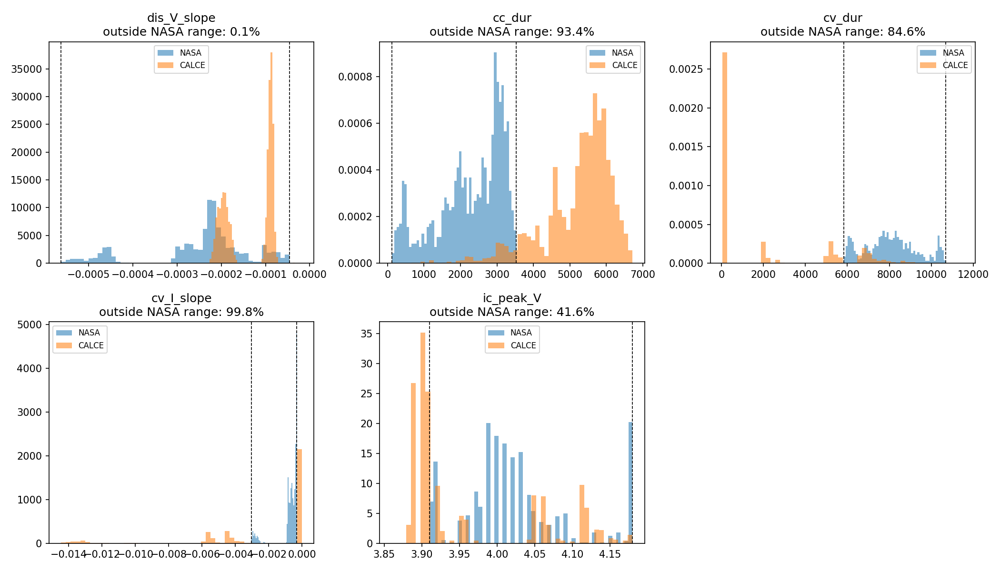
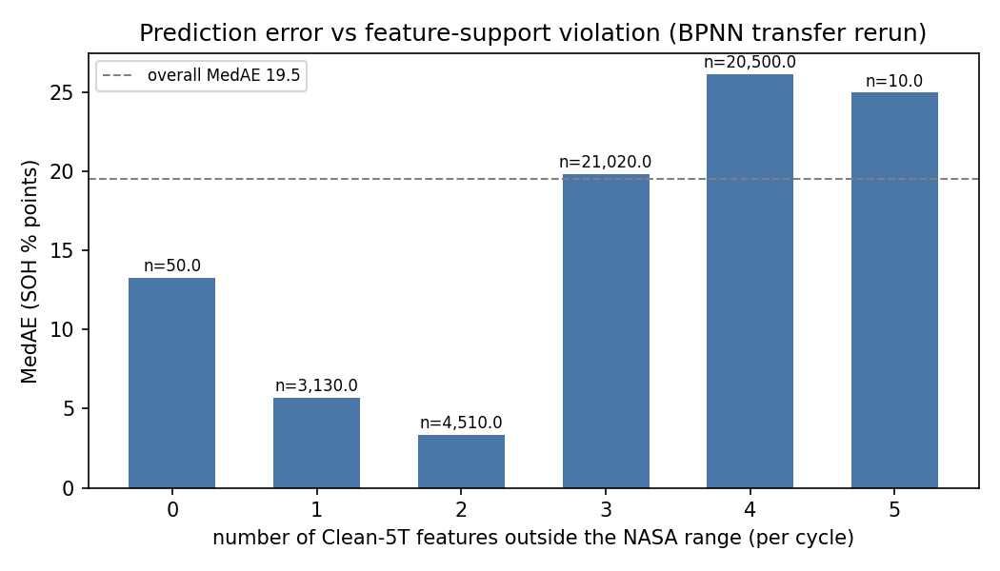
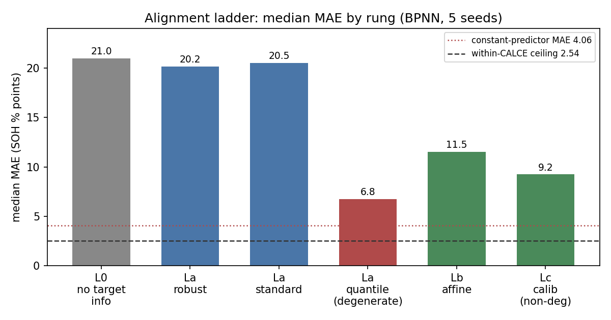

# Round 6 diagnosis report: why NASA to CALCE transfer fails, and what a simple alignment recovers

Date: 2026-10-23
Author: Padipat Aincham (M11452803)
Repository: github.com/DomIncham/soh-thesis-ae-bpnn (branch `main`)

## 1. Purpose, data, and protocol

The Round 6 comment asks for a diagnosis of the NASA to CALCE transfer failure before any
adaptation work, then a test of range and domain alignment in steps that add target
information one level at a time. This report follows that order: raw transfer, common-range
check, feature-support check, one deterministic baseline, then the alignment ladder.

Setup, the same as Round 5:

- Feature set: Clean-5T = dis_V_slope, cc_dur, cv_dur, cv_I_slope, ic_peak_V
- Model: the Round 5 BPNN pipeline; Ridge appears at step 4 as a baseline
- Protocol: rotated battery-wise validation, outer-test isolation, 5 seeds (42, 123, 2024, 7, 99)
- Row sets: NASA 1,033 cycles from 14 cells; CALCE 4,922 cycles from 8 cells
  (include_cell, cap_ok, dropna)
- All error numbers are SOH percentage points
- Number source: per-cycle prediction dumps in the repository; the report quotes dump
  numbers. The rung CSV files hold rounded per-battery means and can differ by up to 1 point.

Fallback disclosure (R6-C4): the selection fallback rate (sel_degenerate) is 0.80 in the
transfer rerun and at every ladder rung. The rate is a selection-level value: 80% of the
(pool, seed) selection runs hit the early-stopping guard, and the value is copied to the rows
of that run. It stays at the same level across all rungs, so it does not favor one alignment
method over another. Ridge has no selection step, so its fallback is N/A.

## 2. Raw transfer (the L0 reference)

The Round 5 transfer run was repeated with per-cycle prediction output. The repeat matched
Round 5 on all 80 result rows (same selected configs, same early-stopping epochs, same
MAE/RMSE/R2 to three decimals), so every number below rests on the same trained models as
Round 5.

| Metric | Value |
|---|---|
| Median MAE | 20.99 |
| MedAE | 19.51 |
| Median R2 | -28.3 |
| Share of predictions above 115% SOH | 0.486 |
| Fallback (R6-C4) | 0.80 |

Source: phase6_preds_transfer_full.csv, phase6_transfer_rerun_c5t.csv.

## 3. Step 1: feature distributions, NASA vs CALCE

Per-feature comparison on the raw values (KS statistic on the full row sets):

| Feature | % below NASA range | % above NASA range | % outside | KS |
|---|---|---|---|---|
| dis_V_slope | 0.0 | 0.1 | 0.1 | 0.588 |
| cc_dur | 0.0 | 93.4 | 93.4 | 0.934 |
| cv_dur | 84.5 | 0.1 | 84.6 | 0.845 |
| cv_I_slope | 37.5 | 62.3 | 99.8 | 0.623 |
| ic_peak_V | 41.6 | 0.0 | 41.6 | 0.549 |

All KS p-values are below 1e-239. Four of the five features sit outside the NASA range for
41% to 100% of CALCE cycles. This table uses the per-feature (univariate) min-max definition.

Source: phase6_feature_shift.csv, phase6_feature_shift_summary.md.

## 4. Step 2: common-SOH-range diagnostic

The SOH ranges overlap at about 87-101% (a substantial range mismatch with partial overlap,
per the Round 6 wording note). A diagnostic on that band answers how much of the failure
comes from SOH-range extrapolation.

| Metric | Value |
|---|---|
| Rows in the 87-101% band (n) | 39,870 (81% of all cycles) |
| MedAE in band | 19.33 |
| P90 error in band | 48.74 |
| MedAE on all rows (for comparison) | 19.51 |
| Fallback (R6-C4) | 0.80 |

The error inside the overlap band is close to the error on all rows. SOH-range extrapolation
is a small part of the failure. This is a diagnostic, not a final performance result.

Source: phase6_common_range_diag.csv, phase6_loophole_closures.csv (C4).

## 5. Step 3: feature-support split

The strict split uses all 5 features (a row is inside when every feature sits within the NASA
min-max range). The inside group holds 50 cycles, which is too small to carry the comparison
alone, so the analysis also counts how many features fall outside (n_out) per cycle.

| Group | n | MAE | MedAE | P90 | Share above 115% |
|---|---|---|---|---|---|
| Inside, strict (n_out = 0) | 50 | 11.90 | 13.26 | 20.90 | 0.000 |
| Outside, strict (n_out >= 1) | 49,170 | 23.53 | 19.52 | 48.33 | 0.486 |
| 1-2 features outside | 7,690 | 9.21 | 4.45 | 25.67 | 0.10 |
| 3-5 features outside | 41,530 | 24.54 | 22.54 | 49.30 | 0.55 |
| Fallback (R6-C4) | - | 0.80 | 0.80 | 0.80 | 0.80 |

Three checks support the reading:

1. The jump sits between 2 and 3 features outside. A paired test across the 10 runs puts the
   low group ahead in 10 of 10 runs (Wilcoxon p = 0.002).
2. Bad predictions (above 115%) track the support violation: chi-square 5,413 against n_out
   and 8,899 against cell, both p < 0.001.
3. The error follows the size of the violation, not just the count. Rows with 1-2 features
   outside show a median cc_dur overshoot of 0.037 of the NASA range; rows with 3-5 outside
   show 0.59, and cv_dur sits near -1.18 (at or below the NASA minimum). Figure 2 shows the
   gradient.

The 1-2-outside rows predict better than the inside corner cases. These rows keep
NASA-like charge dynamics with small violations, so the model interpolates them well. The
gradient is a property of the trained model: the fallback rate applies to both groups in the
same way (see the guards file for the 10/10 run-level check).

Source: phase6_support_split.csv, phase6_dump_with_support.csv, phase6_interpretation_guards.md.

## 6. Step 4: Ridge baseline

One deterministic baseline, the same Clean-5T features and the same rotated selection
protocol. No model comparison was added beyond this.

| Model | Domain | Median MAE | Median R2 | Fallback (R6-C4) |
|---|---|---|---|---|
| BPNN | within-CALCE | 2.54 | 0.58 | 0.80 |
| Ridge | within-CALCE | 2.68 | 0.45 | N/A (deterministic) |
| BPNN | transfer | 20.99 | -28.3 | 0.80 |
| Ridge | transfer | 51.14 | -148.7 | N/A (deterministic) |

Ridge sits close to BPNN inside CALCE and fails far harder under transfer. Two checks tie the
failure to the data rather than to a model class:

1. Both families fail on the same cycles: 96.9% of the rows where both models are wrong by
   more than 20 points sit in the 3-5-features-outside zone.
2. Ridge degrades with support violation at a faster rate than BPNN (MedAE 14.9 to 55.2,
   against 4.5 to 22.5). This is the expected pattern when the target function itself needs
   extrapolation.

Source: phase6_ridge_transfer.csv, phase6_ridge_within.csv, phase6_baseline_closure.md.

## 7. Step 5: alignment ladder

Each rung adds one level of target information. The backbone model and the selection
protocol stay the same at every rung.

| Rung | Target information | Median MAE | MedAE | Share above 115% | Fallback (R6-C4) |
|---|---|---|---|---|---|
| L0 | none (reference) | 20.99 | 19.51 | 0.486 | 0.80 |
| La robust | none (source-side scaler) | 20.17 | 19.60 | - | 0.80 |
| La standard | none (source-side scaler) | 20.51 | 20.61 | - | 0.80 |
| La quantile | none (source-side scaler) | 6.76 | 5.82 | 0.000 | 0.80 |
| La quantile, variance restored | none (control) | 37.27 | 36.77 | 0.902 | 0.80 |
| Lb affine | target training features, no labels | 11.53 | 12.49 | 0.000 | 0.80 |
| Lb PCA reconstruct | target training features, no labels | 20.99 | 19.51 | 0.486 | 0.80 |
| Lc one-cell calibration | one labeled target cell | 9.24 (non-degenerate) | - | 0.062 | 0.80 |

Source: phase6_ladder_La.csv, phase6_ladder_Lb.csv, phase6_ladder_Lc.csv,
phase6_ladder_preds.csv.

### 7.1 The La-quantile result is degenerate alignment

La-quantile reaches MAE 6.76 with R2 = -1.25. A constant predictor that outputs the mean SOH
of the test rows reaches MAE 4.06, which beats the model. Per cell, the std of the
predictions is 0.063 of the std of the target, so the model draws a flat line per cell. When
the feature variance was restored after the quantile mapping, MAE rose to 37.27 and 90% of
predictions went above 115%. The quantile transform flattens the target features (93% to
100% of them sit at the transform bounds), which removes extrapolation and the signal at the
same time. The report counts this rung as degenerate alignment, not as a success. The
interventional test closes the question of what caused the low MAE.

### 7.2 What the ladder recovers

Matched row-set comparison (the same cells on both sides of each comparison):

| Method | MAE | Matched L0 MAE | Gap recovered |
|---|---|---|---|
| Lb affine (no labels) | 12.47 | 24.64 | 49% |
| Lc calibration (one labeled cell, non-degenerate) | 11.09 | 26.44 | 58% |

The within-CALCE ceiling for BPNN is a median MAE of 2.54. The simplest defensible alignment
recovers about half of the transfer gap. The Lb result uses no labels: it matches each target
feature's median and IQR to the source scale, fitted on the 7 target training cells, and the
code asserts that the held-out test cell never enters any fit.

## 8. Answers to the Round 6 questions

Why does the transfer fail? Three findings line up:

1. Four of the five Clean-5T features sit outside the NASA range for 41% to 100% of CALCE
   cycles.
2. The error stays high inside the common SOH band, so SOH-range extrapolation explains a
   small part of the failure.
3. Prediction error tracks the number and the size of feature-support violations, and two
   model families fail on the same cycles.

The results indicate a feature-space domain shift. The failure is consistent with the shift,
and the support-split evidence plus the shared-cycle evidence make it the leading explanation.

How much does the simplest defensible alignment recover? Affine feature alignment on target
training cells recovers 49% of the gap with no labels; one-cell output calibration recovers
58% on non-degenerate runs. The remaining half needs labeled target data, which the Round 6
plan places after calibration.

## 9. Disclosures and limits

1. Clean-6T ablation: deferred. The Round 6 comment permits Clean-6T as an ablation for
   adaptation experiments; the Round 5 adapt2 result (Clean-6T better on all 8 cells) stands
   as the Clean-6T evidence, and the ablation run was not repeated in Round 6.
2. Fine-tuning after calibration was not tried. The advisor's ladder places one-cell
   calibration before additional fine-tuning; this report stops at the calibration rung and
   leaves fine-tuning as the next step.
3. La-quantile is degenerate alignment (Section 7.1). It must not be read as a recovery.
4. Lc calibration: 45 of 80 runs are degenerate (slope at or below 0, or far from 1). The
   reportable number is the non-degenerate median MAE of 9.24.
5. The fallback rate of 0.80 is a selection-level value copied to result rows. It is
   identical across all rungs and both support groups, so it does not confound the
   comparisons in this report, but it marks the selection pipeline as unstable on its own.
6. Smoke runs are nondeterministic (a smoke repeat gave different selected configs). All
   conclusions rest on the full runs, which reproduced Round 5 on all 80 rows.
7. Two model families were tested (BPNN, Ridge). The Round 6 comment rules out a wider model
   study, so the model-class claim rests on convergent evidence and shared failing cycles.
8. The n_out = 0 group holds 50 rows. Claims about that group carry low weight in this
   report.

## 10. Code and evidence files

Code:

- [phase5_cs2_clean5t.py](https://github.com/DomIncham/soh-thesis-ae-bpnn/blob/main/Autoencoder/round3_phase1/phase5_cs2_clean5t.py) (transfer rerun with per-cycle dump, R6-C3 parity check)
- [phase6_feature_shift.py](https://github.com/DomIncham/soh-thesis-ae-bpnn/blob/main/Autoencoder/round3_phase1/phase6_feature_shift.py) (step 1)
- [phase6_support_split.py](https://github.com/DomIncham/soh-thesis-ae-bpnn/blob/main/Autoencoder/round3_phase1/phase6_support_split.py) (step 3)
- [phase6_ridge_baseline.py](https://github.com/DomIncham/soh-thesis-ae-bpnn/blob/main/Autoencoder/round3_phase1/phase6_ridge_baseline.py), [phase6_ridge_within.py](https://github.com/DomIncham/soh-thesis-ae-bpnn/blob/main/Autoencoder/round3_phase1/phase6_ridge_within.py) (step 4)
- [phase6_alignment_ladder.py](https://github.com/DomIncham/soh-thesis-ae-bpnn/blob/main/Autoencoder/round3_phase1/phase6_alignment_ladder.py) (step 5)
- [phase6_loophole_closures.py](https://github.com/DomIncham/soh-thesis-ae-bpnn/blob/main/Autoencoder/round3_phase1/phase6_loophole_closures.py) (pre-report audit, self-checked)

Evidence:

- [phase6_feature_shift.csv](https://github.com/DomIncham/soh-thesis-ae-bpnn/blob/main/Autoencoder/round3_phase1/phase6_feature_shift.csv) (5 rows, step 1)
- [phase6_common_range_diag.csv](https://github.com/DomIncham/soh-thesis-ae-bpnn/blob/main/Autoencoder/round3_phase1/phase6_common_range_diag.csv) (10 rows, step 2)
- [phase6_support_split.csv](https://github.com/DomIncham/soh-thesis-ae-bpnn/blob/main/Autoencoder/round3_phase1/phase6_support_split.csv) (20 rows, step 3)
- [phase6_dump_with_support.csv](https://github.com/DomIncham/soh-thesis-ae-bpnn/blob/main/Autoencoder/round3_phase1/phase6_dump_with_support.csv) (49,220 rows, step 3)
- [phase6_ridge_transfer.csv](https://github.com/DomIncham/soh-thesis-ae-bpnn/blob/main/Autoencoder/round3_phase1/phase6_ridge_transfer.csv) (80 rows), [phase6_ridge_within.csv](https://github.com/DomIncham/soh-thesis-ae-bpnn/blob/main/Autoencoder/round3_phase1/phase6_ridge_within.csv) (40 rows), step 4
- [phase6_ladder_La.csv](https://github.com/DomIncham/soh-thesis-ae-bpnn/blob/main/Autoencoder/round3_phase1/phase6_ladder_La.csv) (320 rows), [phase6_ladder_Lb.csv](https://github.com/DomIncham/soh-thesis-ae-bpnn/blob/main/Autoencoder/round3_phase1/phase6_ladder_Lb.csv) (160 rows), [phase6_ladder_Lc.csv](https://github.com/DomIncham/soh-thesis-ae-bpnn/blob/main/Autoencoder/round3_phase1/phase6_ladder_Lc.csv) (80 rows), step 5
- [phase6_preds_transfer_full.csv](https://github.com/DomIncham/soh-thesis-ae-bpnn/blob/main/Autoencoder/round3_phase1/phase6_preds_transfer_full.csv) (49,220 per-cycle rows, L0 reference)
- [phase6_final_audit.md](https://github.com/DomIncham/soh-thesis-ae-bpnn/blob/main/Autoencoder/round3_phase1/phase6_final_audit.md) (advisor-comment coverage matrix), [phase6_loophole_audit.md](https://github.com/DomIncham/soh-thesis-ae-bpnn/blob/main/Autoencoder/round3_phase1/phase6_loophole_audit.md) (closure audit)

Figures: phase6_feature_hist.png (Figure 1), phase6_support_gradient.png (Figure 2),
phase6_ladder_progress.png (Figure 3); drawing code in
[phase6_figures.py](https://github.com/DomIncham/soh-thesis-ae-bpnn/blob/main/Autoencoder/round3_phase1/phase6_figures.py).
